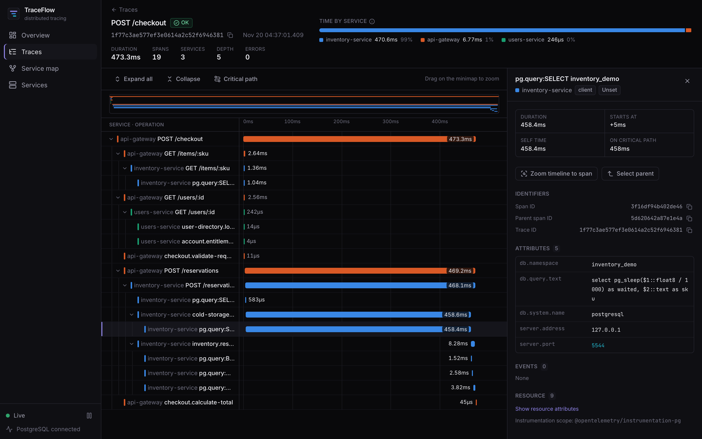
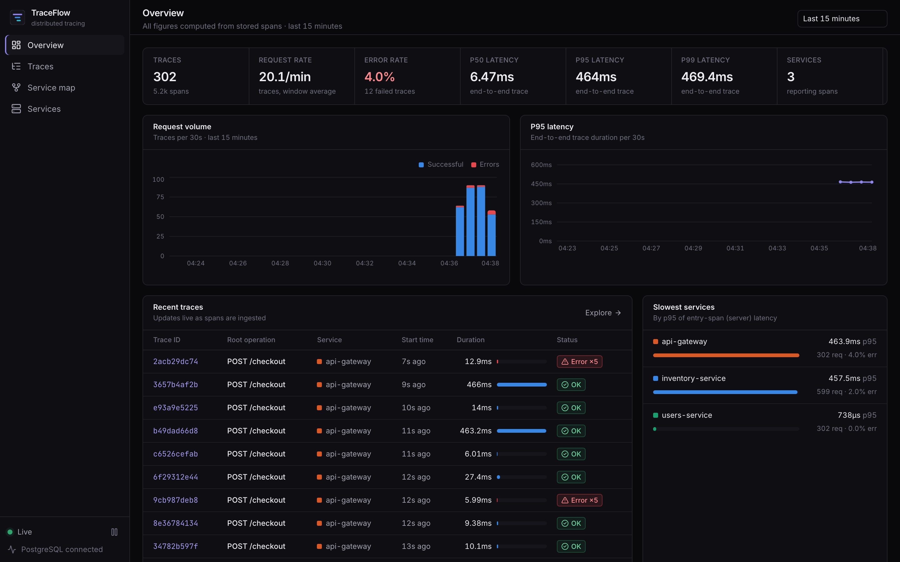
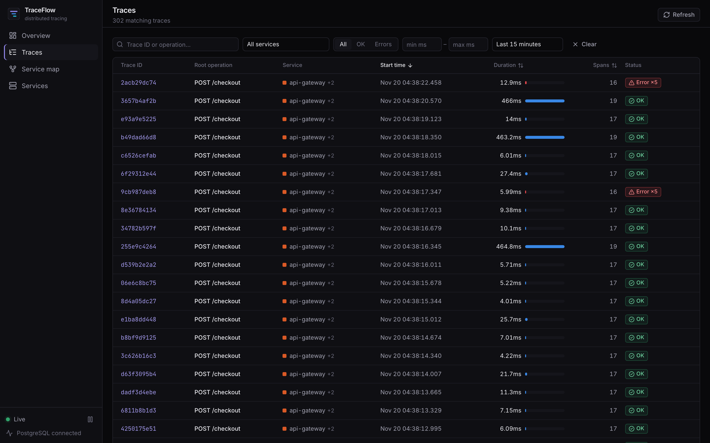
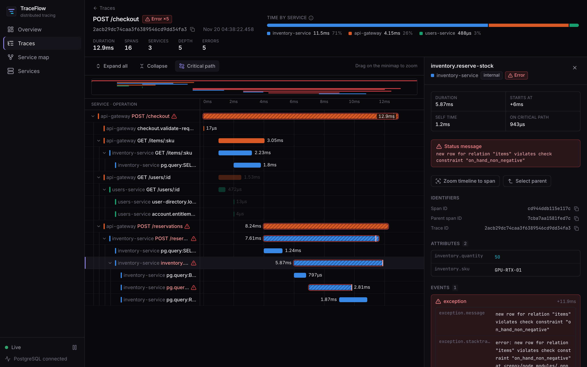
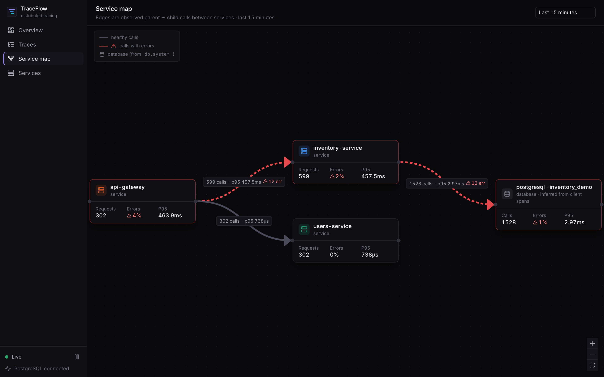
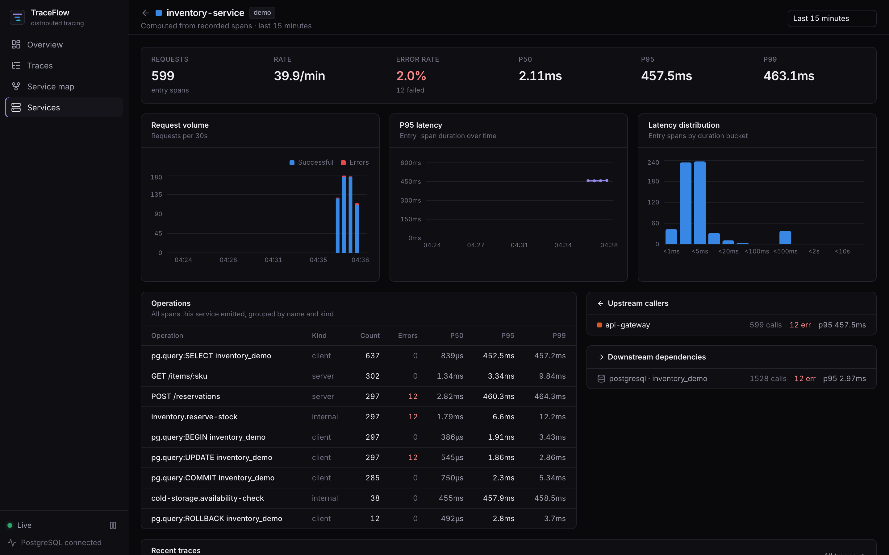

# TraceFlow

**A lightweight distributed tracing backend and dashboard, built from scratch on OpenTelemetry.**

TraceFlow receives real OpenTelemetry traces over OTLP/HTTP, stores them in
PostgreSQL, reconstructs each request's path across services, and shows where
the time went — in a live dashboard with a trace waterfall, critical-path
analysis, a service dependency map and per-service latency/error metrics.

It ships with three genuinely instrumented Node.js microservices, so every
trace you see in the screenshots below was produced by real HTTP calls,
real W3C Trace Context propagation and real PostgreSQL queries.



<sub>Scenario B: a 480 ms checkout. The waterfall, the critical path and "time by service" all point at one PostgreSQL query in the Inventory service.</sub>

---

## Contents

- [Why this exists](#why-this-exists)
- [Features](#features)
- [Architecture](#architecture)
- [Quick start](#quick-start)
- [Demo scenarios](#demo-scenarios)
- [Screenshots](#screenshots)
- [Testing](#testing)
- [Key engineering decisions](#key-engineering-decisions)
- [Technology choices](#technology-choices)
- [Limitations](#limitations)
- [Future work](#future-work)
- [Project layout](#project-layout)

## Why this exists

In a microservice system a single user request fans out across processes. Logs
and per-service metrics tell you _that_ checkout is slow, not _which hop_ made
it slow. Distributed tracing solves that by giving every request a trace id
that travels with each network call, recording each unit of work as a timed
span, and joining the spans back together centrally.

TraceFlow implements the backend half of that pipeline — ingestion,
storage, trace assembly and analysis — and is small enough to read in an
afternoon. It is inspired by the concepts behind Jaeger and Grafana Tempo,
not by their code.

## Features

**Ingestion (`apps/collector`)**

- OTLP/HTTP **JSON** trace receiver (`POST /v1/traces`), gzip/deflate support
- Per-span validation with OTLP `partialSuccess` responses
- Idempotent writes (duplicate/retried spans are no-ops)
- Order-independent trace assembly — children may arrive before parents, roots may never arrive
- Per-trace advisory locks so concurrent batches of one trace can't produce stale summaries
- `503 + Retry-After` when storage is down, so OpenTelemetry SDKs retry instead of dropping data

**Query API (`apps/api`)**

- Trace search with text/trace-id search, service, status, duration and time filters, sorting and pagination
- Trace detail with nanosecond-exact relative offsets
- Overview KPIs, per-service RED metrics, operations, latency histograms
- Service dependency graph derived only from observed parent → child links
- Live updates over Server-Sent Events, fed by PostgreSQL `LISTEN/NOTIFY`
- OpenAPI 3.1 spec (`/api/openapi.json`), with a test that fails if a route is undocumented

**Dashboard (`apps/web`)**

- Overview: traces, request rate, error rate, p50/p95/p99, services, volume and latency charts, recent traces, slowest services
- Trace explorer with URL-encoded filters (shareable views)
- **Trace waterfall**: nested, collapsible span tree; accurate timeline; service colours; error indicators; span inspector (attributes, events, resource, links); critical path; self time and "time by service"; minimap zoom; graceful handling of missing parents; virtualised for 10k-span traces; keyboard navigable
- Service map (React Flow) with request counts, error rates and p95 per node and edge
- Service detail: volume, latency over time, latency distribution, operations, upstream/downstream dependencies, recent traces
- Loading, empty and error states everywhere; live/reconnecting indicator

**Example system (`examples/microservices`)**

- `api-gateway`, `users-service`, `inventory-service` (Fastify, OpenTelemetry SDK, real `pg` queries)
- Deterministic scenario script (healthy / slow / failing) and a seeded traffic generator

## Architecture

```
  api-gateway ──traceparent──▶ users-service
       │
       └──────traceparent──▶ inventory-service ──▶ PostgreSQL (inventory_demo)
       │                            │
       └──── OpenTelemetry SDK ─────┴── OTLP/HTTP JSON ──┐
                                                         ▼
                                  ┌───────────────────────────────────────┐
                                  │ collector :4318                       │
                                  │ validate → normalize → one txn:       │
                                  │ upsert services · lock trace ·        │
                                  │ insert spans (idempotent) ·           │
                                  │ recompute summaries · pg_notify       │
                                  └──────────────────┬────────────────────┘
                                                     ▼
                                           PostgreSQL (traceflow)
                                                     │  SQL + LISTEN
                                                     ▼
                                  ┌───────────────────────────────────────┐
                                  │ API :4400  REST · SSE · OpenAPI       │
                                  └──────────────────┬────────────────────┘
                                                     ▼
                                  ┌───────────────────────────────────────┐
                                  │ Dashboard :5180  React · TanStack     │
                                  │ Query · React Flow · Recharts         │
                                  └───────────────────────────────────────┘
```

The full design discussion — data model, ingestion algorithm, concurrency,
query design, live updates, failure handling and trade-offs — is in
**[docs/ARCHITECTURE.md](docs/ARCHITECTURE.md)**.

## Quick start

**Requirements:** Node.js ≥ 22.12, pnpm (via `corepack enable`), Docker. No
cloud services, API keys or network access are needed after `pnpm install`.
Developed on an Apple Silicon MacBook Pro (M3 Pro, 18 GB).

```bash
pnpm install
```

```bash
pnpm db:up        # PostgreSQL 17 on 127.0.0.1:5544 (docker compose)
```

```bash
pnpm db:migrate   # create tables and indexes
```

```bash
pnpm dev          # collector :4318, API :4400, dashboard :5180
```

Open **http://localhost:5180**. Then, in a second terminal, start the
instrumented services and send traffic:

```bash
pnpm demo:services   # api-gateway :8101, users :8102, inventory :8103
```

```bash
pnpm demo            # run scenarios A, B and C once and print trace links
```

```bash
pnpm demo:traffic    # ~4 req/s of mixed traffic for 60 s (seeded, reproducible)
```

Traces appear in the dashboard within about a second, without reloading.

<details>
<summary>Production-style run (single port, built dashboard)</summary>

```bash
pnpm build && pnpm start   # API serves the built dashboard at http://127.0.0.1:4400
```

</details>

<details>
<summary>Useful commands and configuration</summary>

| Command            | What it does                                            |
| ------------------ | ------------------------------------------------------- |
| `pnpm db:reset`    | delete all stored telemetry (keeps schema)              |
| `pnpm db:down`     | stop PostgreSQL                                         |
| `pnpm screenshots` | regenerate `docs/screenshots/*` from the running stack  |
| `pnpm check`       | format check, lint, typecheck, unit + integration tests |

All settings are environment variables with local defaults — see
[`.env.example`](.env.example) (`DATABASE_URL`, ports, `CORS_ORIGINS`,
`OTEL_EXPORTER_OTLP_TRACES_ENDPOINT`, `COLD_STORAGE_DELAY_MS`, …). Ports were
chosen to avoid the usual 5432/5173/3000 so TraceFlow can run beside other
projects.
</details>

### Sending traces from your own service

Any OpenTelemetry SDK that can export **OTLP/HTTP JSON** works:

```bash
export OTEL_EXPORTER_OTLP_TRACES_ENDPOINT=http://127.0.0.1:4318/v1/traces
export OTEL_EXPORTER_OTLP_TRACES_PROTOCOL=http/json
```

## Demo scenarios

`pnpm demo` sends one ordinary `POST /checkout` per scenario to the gateway.
The behaviour comes from the services' real code paths — nothing is faked or
injected into TraceFlow.

|     | Scenario         | What happens                                                                                                                                  | What you see                                                                                                                            |
| --- | ---------------- | --------------------------------------------------------------------------------------------------------------------------------------------- | --------------------------------------------------------------------------------------------------------------------------------------- |
| A   | Healthy checkout | Gateway looks up the user and the item **concurrently**, reserves stock in a DB transaction, computes the total                               | ~17 spans across 3 services; the user lookup is off the critical path                                                                   |
| B   | Slow dependency  | The item lives in "cold storage": Inventory runs an availability query with a controlled `pg_sleep` (`COLD_STORAGE_DELAY_MS`, default 450 ms) | One `pg.query` span takes ~95% of the trace; it is on the critical path; "time by service" attributes it to inventory-service           |
| C   | Failed request   | Over-reserving a limited item violates the `on_hand_non_negative` CHECK constraint; PostgreSQL rejects the UPDATE                             | Error status on the DB span → `inventory.reserve-stock` (with an `exception` event) → Inventory 500 → Gateway client span → Gateway 502 |

The script prints each trace id, waits until all spans are stored, and links
to the waterfall. Each gateway response also carries the id in an `x-trace-id`
header.

## Screenshots

All screenshots are of the running application with telemetry generated by
`pnpm demo` and `pnpm demo:traffic`.

| Overview                                             | Trace explorer                                 |
| ---------------------------------------------------- | ---------------------------------------------- |
|  |  |

| Failed request (critical path on)                                       | Service map                                                 |
| ----------------------------------------------------------------------- | ----------------------------------------------------------- |
|  |  |

| Service detail                                                      |
| ------------------------------------------------------------------- |
|  |

## Testing

```bash
pnpm test          # unit + integration (needs `pnpm db:up`)
```

```bash
pnpm test:e2e      # Playwright; starts its own isolated stack on other ports
```

| Suite       | Count | Covers                                                                                                                                                                                                                                                                                                                                                                       |
| ----------- | ----- | ---------------------------------------------------------------------------------------------------------------------------------------------------------------------------------------------------------------------------------------------------------------------------------------------------------------------------------------------------------------------------- |
| Unit        | 56    | OTLP parsing against a payload captured from the real OTel JS exporter, id/uint64/enum normalisation, sanitisation and limits, error classification, percentiles, trace-tree reconstruction (orphans, cycles, 20k-deep chains), self time, critical path, stack-trace path scrubbing                                                                                         |
| Integration | 29    | real PostgreSQL: persistence, duplicates, out-of-order arrival (3 orders → identical summary), 9 concurrent batches of one trace, partial success, gzip and gzip-bomb limit, 503 + Retry-After with the DB down, search/filter/sort/pagination, SQL ↔ TypeScript percentile parity, dependency derivation without invented edges, SSE push + cleanup, CORS, OpenAPI coverage |
| End-to-end  | 6     | browser against collector + API + dashboard + the three instrumented services: live arrival, cross-service parent links, bottleneck on the critical path, error indicators and exception events, explorer filters, service-map edges, 5,000-span trace stays virtualised                                                                                                     |

CI (`.github/workflows/ci.yml`) runs format check, lint, typecheck, unit,
integration and E2E tests against a PostgreSQL service container.

## Key engineering decisions

**Why context propagation matters.** Each service only sees its own spans. The
gateway's outgoing call writes `traceparent: 00-<trace-id>-<span-id>-01`; the
callee's instrumentation reads it and makes its server span a child of the
caller's client span. Without it you'd get three unrelated traces. The E2E
test checks that exact parent link across processes.

**How spans form traces.** Spans share a trace id and point at their parent
by span id. TraceFlow rebuilds the tree from those pointers, tolerating
missing parents (shown as "parent missing", trace marked incomplete) and even
malformed cycles.

**Why ingestion order can't be assumed.** A child ends — and is exported —
before its parent; three processes flush on independent timers; retries
reorder batches; roots can be lost. So the collector never builds a summary
from "what arrived now". It recomputes each affected trace's summary from all
of its stored spans, which makes the result depend only on the set of spans.
Per-trace advisory locks make that correct under concurrent batches.

**How duplicates are handled.** `(trace_id, span_id)` is the primary key and
inserts use `ON CONFLICT DO NOTHING`, so exporter retries are harmless and are
reported as duplicates. Spans are immutable once ended, so first write wins.

**How percentiles are computed.** Exactly, with `percentile_cont` (linear
interpolation, `rank = p·(n−1)`), over trace durations (overview) or entry-span
durations (services). The same function exists in TypeScript and a test
asserts they agree. At high volume you'd switch to mergeable sketches.

**How dependencies are derived.** Only from observed links: a span whose
parent belongs to another service is one call from the parent's service to
the child's. Database nodes are inferred from client spans' `db.system`
attribute and labelled as inferred. Nothing is drawn that the telemetry
doesn't show.

**Why this architecture.** Separate write (collector) and read (API) processes
so ingestion bursts and dashboard queries can't starve each other; PostgreSQL
because transactions, JSONB, `percentile_cont` and `LISTEN/NOTIFY` cover the
MVP with a single dependency; SSE because updates are one-way and it reconnects
natively. Details and the scaling path are in
[docs/ARCHITECTURE.md](docs/ARCHITECTURE.md#12-trade-offs-and-what-id-do-next).

## Technology choices

| Area                | Choice                                                                                                                               | Why                                                                    |
| ------------------- | ------------------------------------------------------------------------------------------------------------------------------------ | ---------------------------------------------------------------------- |
| Language            | TypeScript (strict, `noUncheckedIndexedAccess`) end to end                                                                           | one type system from SQL rows to React props (`packages/shared`)       |
| Servers             | Fastify 5                                                                                                                            | fast, schema-friendly, first-class `inject()` for tests                |
| Database            | PostgreSQL 17                                                                                                                        | transactions, JSONB, GIN, `percentile_cont`, `date_bin`, LISTEN/NOTIFY |
| Schema & migrations | Drizzle ORM / drizzle-kit                                                                                                            | typed schema, generated SQL migrations                                 |
| Queries             | postgres.js tagged templates                                                                                                         | analytical SQL reads better as SQL; parameterised by construction      |
| Validation          | zod                                                                                                                                  | query params and config                                                |
| Telemetry           | OpenTelemetry JS SDK, HTTP + pg instrumentation, OTLP/HTTP exporter                                                                  | the industry standard; no vendor lock-in                               |
| Frontend            | React 19, Vite, Tailwind CSS v4, shadcn/ui-style components on Radix, TanStack Query, TanStack Virtual, React Flow, Recharts, Lucide |                                                                        |
| Tests               | Vitest, Playwright                                                                                                                   |                                                                        |
| Infra               | Docker Compose, pnpm workspaces, GitHub Actions                                                                                      |                                                                        |

## Limitations

Stated plainly so nothing is over-claimed:

- **OTLP support is partial:** traces over OTLP/HTTP with the **JSON** encoding
  only. Protobuf over HTTP returns 415; gRPC, metrics and logs are not implemented.
- **No authentication, authorisation or multi-tenant isolation.** Everything binds
  to localhost by default; do not expose it to a network as is.
- **Single PostgreSQL instance, row storage, no retention policy.** Suitable for
  local development and demos, not for production telemetry volumes.
- **Exact percentiles** are computed from raw rows per query, which gets slower
  as data grows.
- Trace detail returns at most 10,000 spans (the UI says when a trace is truncated).
- Limit/offset pagination; deep pages of very large result sets would need keyset pagination.
- While the database is down the collector rejects (503) rather than buffering;
  durability relies on the exporter's retry queue.
- The dashboard is dark-mode only.

## Future work

- OTLP/HTTP protobuf and OTLP/gRPC receivers
- Columnar span storage (ClickHouse / Parquet) with Postgres for metadata; retention jobs
- Incremental trace-summary merging and per-minute materialised service edges
- Mergeable latency sketches (DDSketch / t-digest) for percentiles at scale
- Search by span attribute (`attributes @> …` with a GIN index), trace comparison
- Tail-based sampling, auth + tenants, exemplar links from metrics and logs

## Project layout

```
apps/
  collector/      OTLP/HTTP JSON receiver: parse, validate, ingest
  api/            REST + SSE query API, OpenAPI
  web/            React dashboard
packages/
  db/             Drizzle schema, SQL migrations, connection + migrate/reset CLIs
  shared/         API types; percentiles; trace tree, self time, critical path
  telemetry/      OpenTelemetry bootstrap for the example services
examples/
  microservices/  api-gateway, users-service, inventory-service + scenario/traffic scripts
e2e/              Playwright tests (isolated stack)
infrastructure/
  docker/         docker-compose.yml, Postgres init script
docs/             ARCHITECTURE.md, openapi.yaml, screenshots
```

## License

MIT
